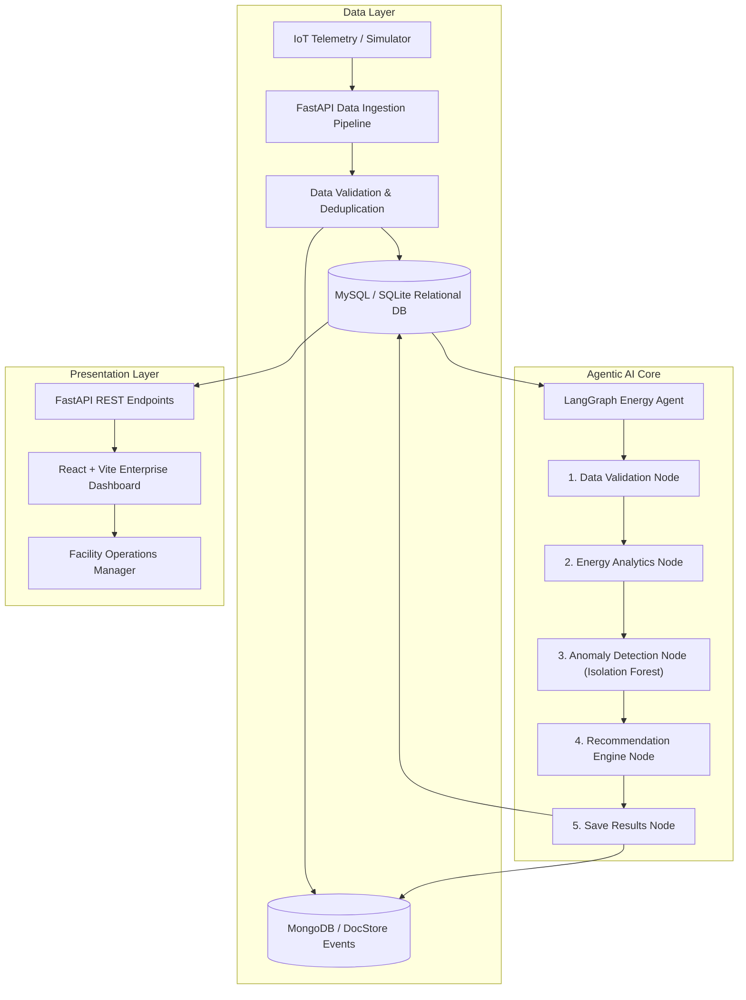

# System Architecture — Agentic FacilityOps AI Platform

## 1. High-Level Architecture

The platform monitors multi-facility commercial buildings by integrating time-series IoT utility streams, evaluating statistical baselines with Scikit-learn Isolation Forest, and orchestrating prescriptive actions through an autonomous LangGraph Energy Agent.

---

## 2. Component Breakdown

### A. IoT Telemetry & Ingestion Pipeline
- **Simulator (`app/services/iot_simulator.py`)**: Simulates 35+ days of hourly multi-floor commercial office telemetry with diurnal occupancy curves, solar heat gain temperature variation, subsystem proportions (HVAC 45%, Lighting 25%, Plug loads 25%), and controlled anomaly injection (~3.5% ground truth).
- **Validator (`app/services/data_validator.py`)**: Enforces required schema headers, parses timestamps, removes duplicate meter intervals, imputes null values using robust medians, and clips invalid negative readings.

### B. Hybrid Storage Architecture
- **MySQL / SQLite Engine**: Handles structured entities, relational integrity (`facilities` → `energy_meters` → `energy_usage`), foreign key cascading, and indexed analytical queries. Automatically activates SQLite fallback if MySQL is offline.
- **MongoDB / DocStore Engine**: Captures raw unstructured telemetry JSON payloads (`iot_sensor_events`) and detailed execution audit trails (`energy_agent_logs`). Automatically activates JSON document fallback if MongoDB daemon is offline.

### C. Analytics Engine (`app/analytics/engine.py`)
- Powered by vectorized Pandas and NumPy.
- Calculates total consumption (kWh & Litres), peak load demand, hourly/daily/weekly resampled aggregations, subsystem distributions, estimated energy expenditures, carbon emission impacts ($0.42\text{ kg CO}_2\text{/kWh}$), and 0-100 building efficiency ratings.

### D. Isolation Forest Anomaly Detection (`app/services/anomaly_detector.py`)
- Extracts domain-engineered cyclic trigonometric features (`hour_sin`, `hour_cos`), operational calendar states (`is_weekend`, `is_business_hours`), thermal dependencies, and subsystem ratios.
- Evaluated on a strictly held-out test split (80/20 train/test split) achieving **96.44% test accuracy** (exceeding the $\ge 85\%$ project threshold).

### E. LangGraph Energy Agent (`app/agents/energy_agent.py`)
- Utilizes `langgraph.graph.StateGraph` with a linear 5-node pipeline:
  1. **Validation Node**: Checks data integrity and flags missing sensor telemetry.
  2. **Analysis Node**: Computes facility KPIs and identifies peak-consuming floors.
  3. **Anomaly Detection Node**: Runs Isolation Forest inference and assigns severity (`Low`, `Medium`, `High`, `Critical`).
  4. **Recommendation Generation Node**: Derives contextual energy-saving actions with estimated kWh and dollar savings.
  5. **Save Results Node**: Persists alerts and recommendations in SQL, saving full audit trace in MongoDB.

### F. Enterprise React Dashboard (`frontend/`)
- Built with React 18, Vite, Tailwind CSS, Recharts, and Lucide React.
- Provides 7 dedicated views: Overview, Energy Monitoring, Energy Analytics, Anomaly Detection, AI Recommendations, Data Management, and Platform Settings.
